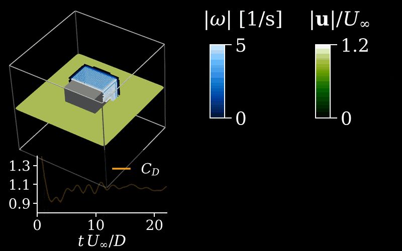

# Coupled cube flow at $Re=1000$

The FVM resolves separation from a no-slip unit cube and its near wake; vortex particles carry the outer wake. Both solvers use equilibrium Smagorinsky LES. The [reference flow](reference_flow/README.md) is a body-fitted FVM grid study of the same problem.

<p align="center">
  
</p>

| Quantity | Value |
| --- | --- |
| Cube side; freestream | 1 m; 1 m/s in $+x$ |
| Density; viscosity | 1 kg/m³; 0.001 m²/s |
| FVM domain | $[-1.8,5.05]\times[-1.8,1.8]^2$ m |
| VPM domain; outflow fringe | $[-4.5,24]\times[-3,3]^2$ m; $x\in[12,24]$ m |
| Cell and particle spacing | 0.045 m |
| FVM step; coupling interval | Courant number 0.9, at most 0.02 s; 0.1 s (5 FVM steps), shorter only where the particle CFL number would pass 0.9; every output interval is a multiple of 0.1 s |
| Coupling iterations | Up to 6 per interval, ended by the transfer tolerances |
| Statistics window | $30\le t\le60$ s |

## Physics and numerical model

`assets/cube.stl` defines the cube for the [body-fitted Cartesian mesh](../../../docs/fvm.md#mesh-setup). Particle boundary data supply normal velocity and the normal gradient of tangential velocity on the outer FVM faces. The FVM then replaces particle vorticity inside the transfer region, with a two-cell buffer and a four-cell blending layer.

The particle wake uses Gaussian cores, RK2 transport, grid-based diffusion and FMM induction. With LES the particles also receive the [selective eddy viscosity](../../../docs/vpm.md#stabilization), which keeps stretched wake vortices above the particle spacing; without it a vortex at $x\approx10$ m collapsed to the spacing and ended a run at $t=33$ s. With the FVM box ending at $x=3.6$ m a second run, with that viscosity, ended the same way at $t=39$ s ($x=6.2$ m): the boundary velocity mismatch at the downstream face had grown from $0.03U_\infty$ before $t=12$ s to $0.5U_\infty$, and the collapsing vortex formed just behind it. The box therefore ends at $x=5.05$ m, 1.5 formation lengths behind the cube; a run with that box showed a mismatch three to five times smaller. Vorticity fades through the outflow fringe rather than being removed at the downstream face. A tilted vortex behind the cube starts asymmetric shedding in both the coupled and reference cases.

The coupler iterates each interval until the transfer tolerances are met, at most 6 times (`max_coupling_iterations=6`, the default). In 65-minute screens on 8 FVM ranks and an RTX 3060 (solver `e97e0343`), the iterations converged in 2 or 3 and took 101 to 217 s of wall time per 0.04 s interval. One iteration took 33 to 45 s per interval near $t=2.4$ s (`coupler.log` of each screen). On the coupled cylinder a single iteration changed the drag by 3 % (`CouplerConfig.max_coupling_iterations`), which is the size of the differences this case measures. A first run with one iteration per interval reached $t\approx12$ s and was stopped, because the coupled cylinder then showed a +3 % drag coupling error with one iteration (`../01_cylinder_shedding_flow/figures/auxiliary/interface_runs.csv`, run `k1`); it is kept as the cost comparison.

## Run

Run commands from this directory.

```bash
(cd reference_flow && ./allrun.sh)
./allrun.sh
./allplot.sh
```

`./allplot.sh` compares the coupled run with the FVM-only reference `reference_flow/samples/grid_h0045_dt0.02`, on the cells and at the FVM step 0.02 s of the coupled box. The field comparison samples the reference onto the coupled mid-plane lattice. The animation `assets/cube_flow.gif` is redrawn only once the run reaches $t=60$ s. `./allrun.sh` starts from $t=0$; `./allcontinue.sh` resumes the latest accepted coupled backup.

The slip walls of the reference domain speed up the stream at the cube; the coupled flow is unbounded. The force comparison divides the reference forces by $(U'/U)^2$ and its Strouhal number by $U'/U$, with Maskell's wake-blockage speed-up $(U'/U)^2 = 1 + 2.5\,C_D S/C$ ($S$ the frontal area, $C$ the cross-section between the walls): $U'/U = 1.008$, forces $-1.6$ %. The mean streamwise velocity beside the cube ($y=\pm2$ m, mid-plane) is 0.7–0.9 % higher in the reference than in the coupled flow, which confirms the size of the correction.

## Results

| File | Content |
| --- | --- |
| `figures/forces` | Drag, side force and lift against the reference |
| `figures/errors_by_window` | Error of the mean forces against the FVM-only reference in consecutive windows, with the 2 % acceptance band: mean drag in 5 s windows from $t=5$ s, rms side force and lift in 10 s windows |
| `figures/interface_measures` | Per coupling interval: rms velocity mismatch per FVM box side and its maximum, FVM budget error, near-wall circulation ratio with the 0.97–1.03 band |
| `figures/velocity_profiles` | Time-mean streamwise velocity and transverse-velocity fluctuation |
| `figures/velocity_fields`, `figures/vorticity_fields` | Mid-plane reference, coupled and difference fields |
| `figures/mean_velocity_field`, `figures/mean_vorticity_field` | The same, averaged over $30\le t\le60$ s |
| `figures/coupling_cost` | Wall time by solver part and particle count |
| `figures/comparison_summary.csv` | Statistics, errors, interface measures and wall time per flow time of the run and the reference |
| `assets/cube_flow.gif` | Mid-plane and particle vorticity with drag history, from the finished run |
| `solution/fvm.pvd`, `solution/vpm.pvd` | FVM fields and particle states for ParaView |
