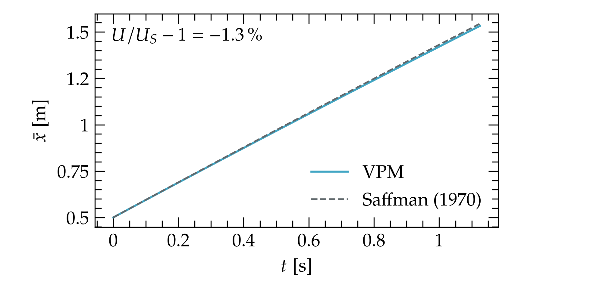
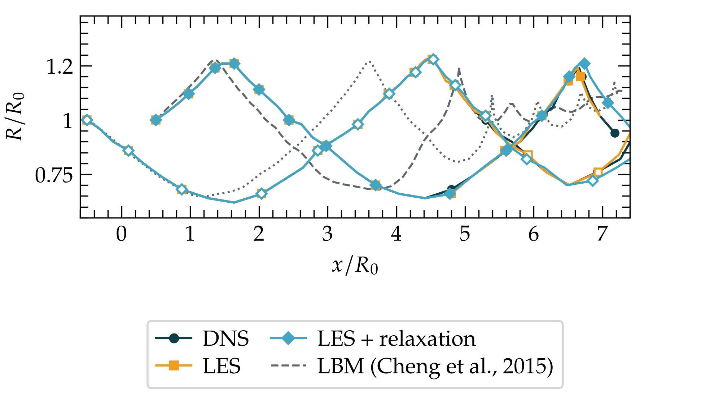
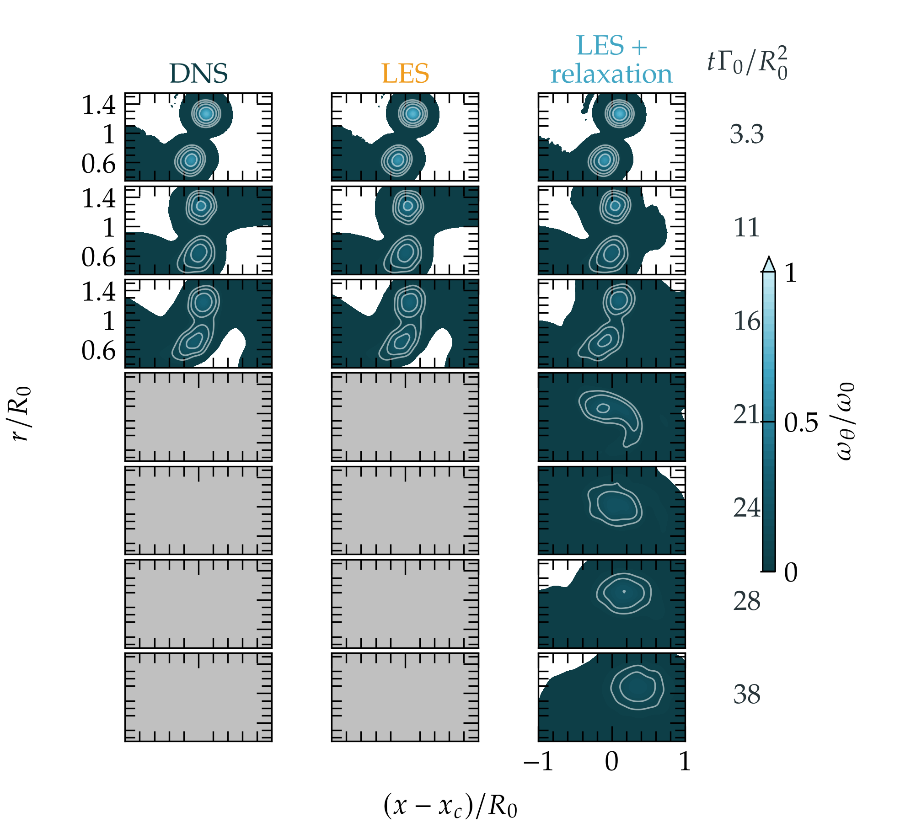
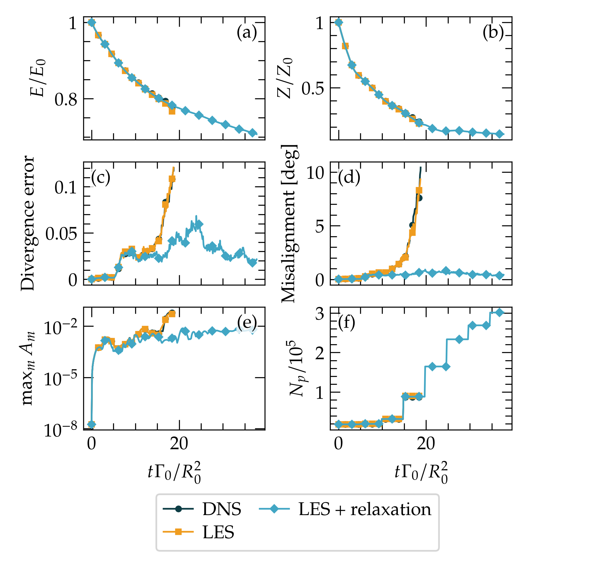
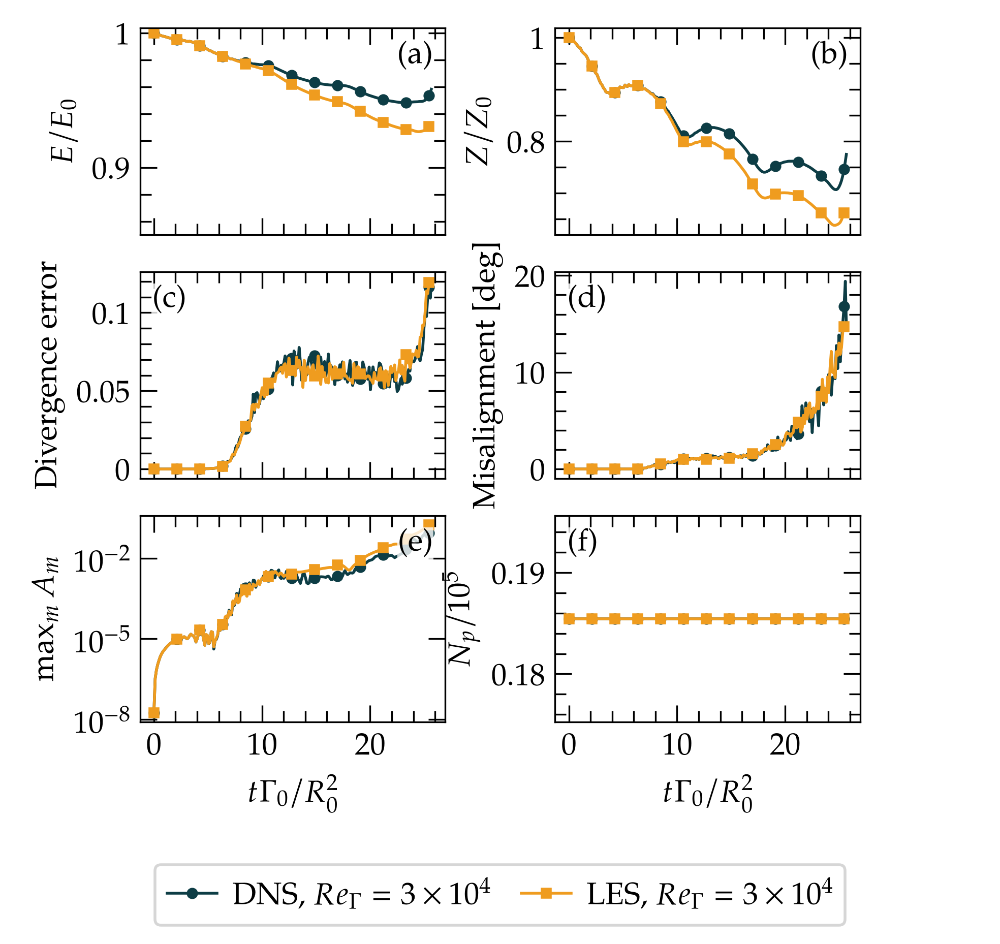

# Leapfrogging rings

Two equal, coaxial Gaussian rings pass through each other in turn, then merge into one ring. The case shows how to keep a vortex-particle run healthy for a long time without changing its physics: a DNS, a selective LES, and the LES with strength relaxation are compared against the lattice Boltzmann (LBM) simulation of [Cheng, Lou & Lim (2015)](assets/references/README.md). See [diffusion and LES](../../../docs/vpm.md#diffusion-and-les) and [long runs](../../../docs/vpm.md#long-runs).

## Run

From this directory:

```bash
./allrun.sh
./allplot.sh
```

`allrun.sh` removes previous results and runs the six cases below, about seven hours on a laptop GPU (RTX 3060). For one case, use `python setup.py les_stabilized`. `./allcontinue.sh` resumes saved checkpoints; `./allplot.sh pdf` exports PDF.

## Inputs

Edit [setup.py](setup.py). Both rings have radius $R_0=1$ m, circulation $\Gamma_0=\pi$ m²/s and Gaussian core $\omega_\theta=\Gamma_0e^{-(r/a_0)^2}/(\pi a_0^2)$ with $a_0=0.1$ m, the convention of the reference. Their centres start at $x=\pm0.5$ m, and no disturbance is added. $Re_\Gamma=\Gamma_0/\nu=3000$.

Particles sit on a toroidal lattice with spacing $h=0.05$ m and cores $\sigma=1.5h$. Core spreading carries the viscosity; when a core reaches $2.2h$ the field is redistributed on the lattice, conserving strength, impulse and each ring's identity. The time step is $\Delta t=0.00375$ s. A run stops when the vorticity-divergence error of the particle field exceeds 0.12, so the stopping time is its lifetime.

| Case | Model |
| --- | --- |
| `single_ring` | One ring for 1.1 s, for the translation speed. |
| `dns` | Molecular viscosity only. |
| `les` | Sigma-model eddy viscosity, switched on where a particle's strength departs from the resolved vorticity, applied by strength exchange. |
| `les_stabilized` | `les` plus Pedrizzetti relaxation, factor 0.02 per step ($5.3$ s⁻¹). |
| `high_re_dns`, `high_re_les` | `dns` and `les` at $Re_\Gamma=3\times10^4$. |

The three rings cases at $Re_\Gamma=3000$ use the fast multipole method (FMM), since redistribution spreads the field over up to $3\times10^5$ particles. The single ring and the $Re_\Gamma=3\times10^4$ cases stay below $5\times10^4$ particles and use direct summation.

## Validation



A single ring moves within 1.3 % of Saffman's speed $U=\Gamma_0/(4\pi R)[\ln(8R/a)-0.558]$ with $a^2=a_0^2+4\nu t$.



The first passage agrees with the LBM: the overtaken ring reaches $R/R_0=1.26$ at $x/R_0=1.46$, against 1.28 at 1.37, and the passing ring contracts to 0.62 (LBM 0.65). The second passage happens at $x/R_0=4.46$, against 3.59 in the LBM. This difference is not a resolution error of the particles: the second passage converges to $x/R_0\approx4.3$ ($4.46$, $4.30$ and $4.28$ at $h=0.05$, $0.035$ and $0.025$ m). Cheng et al. used a periodic box of $7R_0\times7R_0\times20R_0$; the VPM field is unbounded.



Both simulations end the leapfrogging the same way. The passing ring deforms into a sheet, is wrapped around the leading ring and merges with it, as in Fig. 4 of Cheng et al. In the VPM this happens after the third passage ($t\Gamma_0/R_0^2\approx21$), one passage later than in the LBM. The stretched sheet is thinner than $h$ ($\sqrt{\nu/\varepsilon}\approx0.02$ m at the mutual strain $\varepsilon\approx2$ s⁻¹), and the third passage still moves with $h$ ($x/R_0=6.66$ at $h=0.05$, $6.30$ at $h=0.035$), so the timing of the merger is only resolved qualitatively here.

## Lifetime



| Case | Lifetime | $E/E_0$ at 3 s | First azimuthal mode above $10^{-2}$ |
| --- | --- | --- | --- |
| `dns` | 6.0 s | 0.854 | 5.3 s |
| `les` | 6.0 s | 0.852 | 5.2 s |
| `les_stabilized` | 12 s (end of run) | 0.853 | never |

The energy, enstrophy and core paths of the three cases coincide for as long as the DNS runs. The DNS stops when the particle field fails. Panel (d) shows the cause: the strengths drift away from the vorticity they induce (misalignment) a second before the divergence error rises (panel c). The rings themselves are still smooth. Panel (e) shows the azimuthal amplitude $A_m$, the strength-weighted Fourier content of each ring around the axis. It starts at the level of the FMM and lattice noise and stays small: the flow remains axisymmetric, as in the LBM.

**The LES leaves this flow alone, as it should.** At $Re_\Gamma=3000$ and this resolution the rings are laminar. There is no three-dimensional sub-grid motion for the model to remove, and the consistency switch keeps the eddy viscosity below the molecular value. What the coarse particles miss is the axisymmetric core deformation during a passage. That needs a finer $h$, not an eddy viscosity.

**Relaxation fixes the particle field.** Each step turns every strength a fraction 0.02 toward the vorticity at its particle, then restores the net strength and impulse. This removes the misalignment before stretching can amplify it. The run continues through the merger to 12 s with the same energy history.

Calibration of the relaxation factor (separate runs to 9 s):

| Factor per step | Rate | Largest divergence error | First $A_m>10^{-2}$ |
| --- | --- | --- | --- |
| 0 (`les`) | — | stopped at 6.0 s | 5.2 s |
| 0.005 | 1.3 s⁻¹ | 0.114, during the merger | 5.5 s |
| 0.02 | 5.3 s⁻¹ | 0.058 | never |
| 0.05 | 13 s⁻¹ | 0.049 | never; helicity rises 3 s later than in the DNS |

Too little relaxation leaves the run on the edge of the divergence limit; too much also delays three-dimensional growth. The chosen 0.02 per step keeps the field healthy and lies between the physical growth rates (about 1 s⁻¹) and the core vorticity (35–100 s⁻¹).

## Higher Reynolds number



At $Re_\Gamma=3\times10^4$ the cores hardly spread, no redistribution occurs, and the particle field degrades through misalignment as at $Re_\Gamma=3000$. The DNS stops at 8.2 s and the LES at 8.1 s. Before the field fails, the LES removes about 1.5 % more energy than the DNS by 6 s, a small cost next to a Smagorinsky model with $C_s=0.2$, which in a separate run had removed 15 % by 3 s (DNS: 2 %), the dissipation of a $Re_\Gamma=3000$ flow. Here too the run ends because the particles stop representing the vorticity, which relaxation addresses and an eddy viscosity does not. A run seeded with an $n=9$ disturbance of $0.005R_0$ was the only case in this study in which the LES lived longer than the DNS (6.4 s against 5.7 s).

## Read the results

`samples/<case>/` holds flow integrals, ring diagnostics, azimuthal modes and the meridional vorticity planes. `solution/<case>/` holds checkpoints and logs. Core paths follow the two strongest vorticity maxima on the plane $z=0$ and end when a bridge between them prevents assigning two cores, at the merger.
