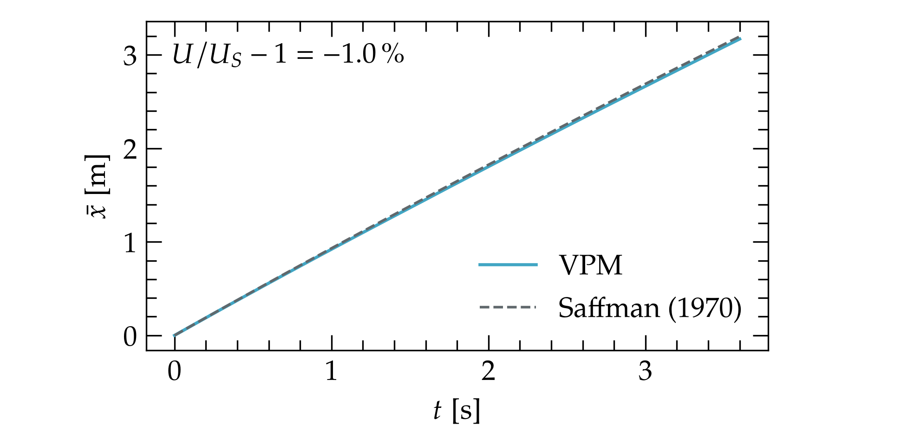

# Vortex ring speed

One Gaussian vortex ring translates through still fluid for 3.6 s, $t\Gamma_0/R_0^2=11.3$. Its speed is compared with Saffman's formula for a viscous Gaussian ring. The case shows how a long particle run keeps its cores resolved: core spreading carries the viscosity, and the particles are redistributed on the lattice only when the cores have grown. See [diffusion](../../../docs/vpm.md#diffusion-and-les) and [long runs](../../../docs/vpm.md#long-runs). Two interacting rings are in [interacting vortex rings](../08_vortex_ring_interactions/README.md).

## Run

From this directory:

```bash
./allrun.sh
./allplot.sh
```

The particles run on a GPU (CUDA, Vulkan or Metal) with `compute_device="auto"`, which never falls back to the CPU; without a GPU the run stops with a message. The run takes about 10 minutes on an RTX 3060. `./allcontinue.sh` resumes the saved backups.

## Inputs

Edit [setup.py](setup.py):

| Quantity | Value |
| --- | --- |
| Radius $R_0$; circulation $\Gamma_0$ | 1 m; $\pi$ m²/s |
| Gaussian core, $\omega_\theta=\Gamma_0e^{-(r/a_0)^2}/(\pi a_0^2)$ | $a_0=0.1$ m |
| $Re_\Gamma=\Gamma_0/\nu$ | 3000 |
| Particle spacing $h$; core $\sigma/h$ | 0.05 m; 1.5 |
| Redistribution | when core spreading has grown $\sigma$ to $2.2h$, checked every 20 steps |
| Step $\Delta t$; duration | 0.00375 s; 3.6 s (960 steps) |

Induction is direct summation. The run stops if the vorticity-divergence error of the particles exceeds 0.12 or the step no longer resolves the velocity gradient.

## Result



Saffman's speed for a Gaussian core with $a\ll R$ is

$$
U=\frac{\Gamma_0}{4\pi R}\left[\ln\frac{8R}{a}-0.558\right],\qquad a^2=a_0^2+4\nu t,
$$

evaluated with the ring radius $R$ from the linear impulse of the particles. A straight-line fit of the strength-weighted centroid over $0.2\le t\le3.6$ s gives $U=0.875$ m/s against $U_S=0.884$ m/s, 1.0 % slow ([ring_speed.json](figures/auxiliary/ring_speed.json)). The first 0.2 s are left out while the particle cores settle.

`samples/single_ring/` holds the flow integrals and the ring diagnostics (centroid, radius, circulation and impulse) every 10 steps; `solution/single_ring/` holds backups every 200 steps.
