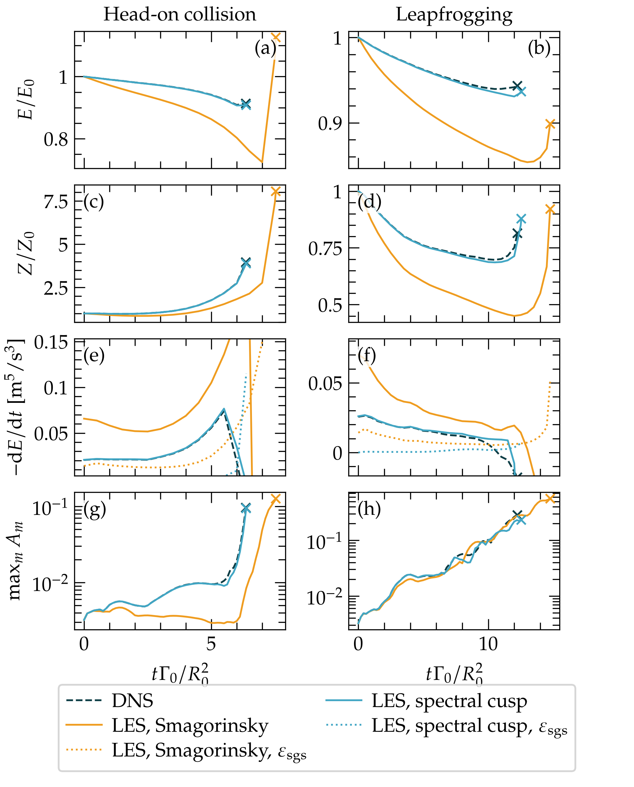
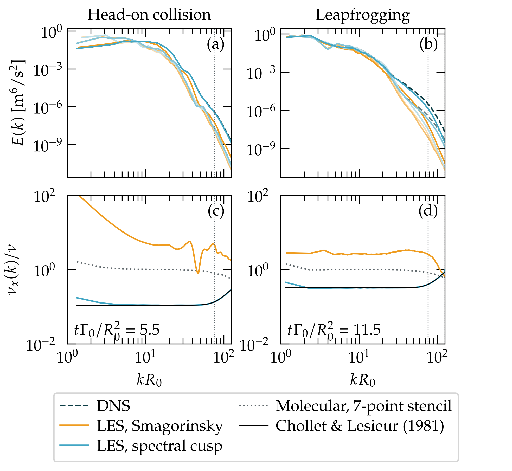
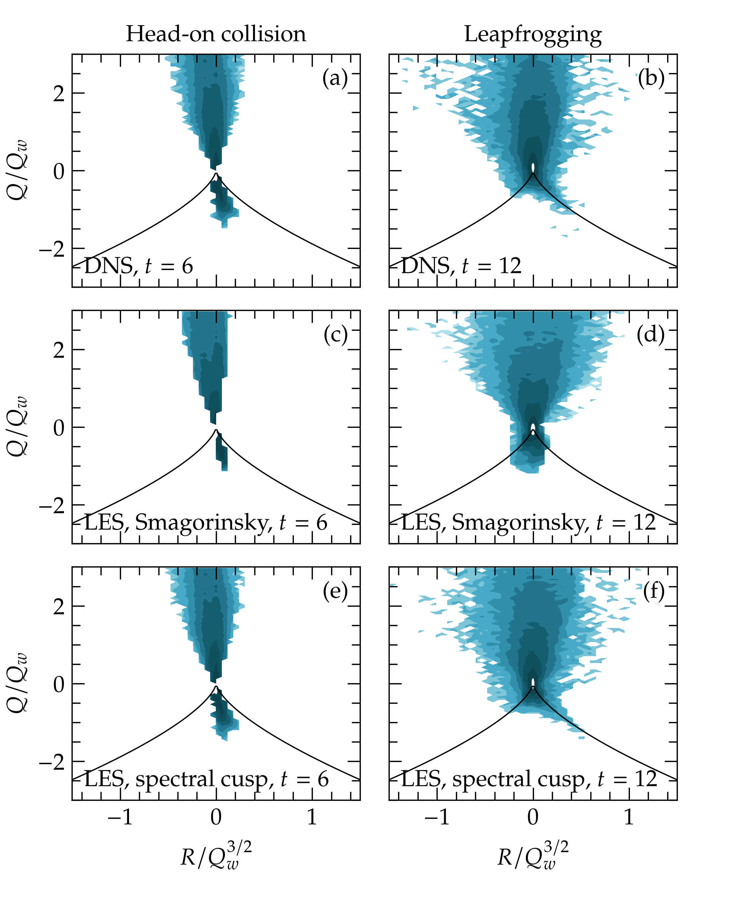
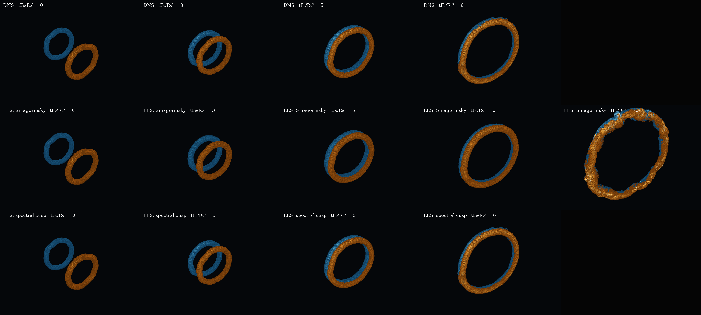
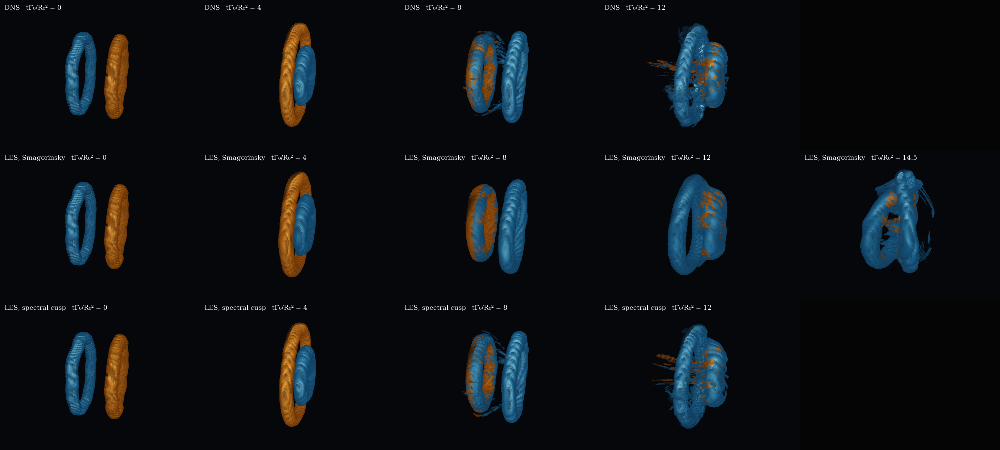

# Interacting vortex rings: DNS against two LES closures

Two Gaussian vortex rings at $Re_\Gamma=2\times10^4$, each seeded with a large Widnall disturbance, either collide head-on or leapfrog. Both flows use the particle numerics of the coupled cases, grid-based diffusion (GBD) with the M4′ kernel. Each flow runs three times:

| Run | Closure |
| --- | --- |
| `dns` | Molecular viscosity only. |
| `les` | Equilibrium Smagorinsky in the GBD Laplacian, with the selective eddy viscosity it switches on, as in the coupled cases. |
| `les_cusp` | Spectral eddy viscosity with the Kraichnan cusp, applied to the GBD lattice in Fourier space ([LES](../../../docs/vpm.md#diffusion-and-les)). |

The particle spacing resolves the initial cores but not the secondary vortices that the instability creates, so the DNS is under-resolved once the rings break down. The case measures what each closure then does: where in wavenumber it removes energy, how much, and how long each run lives.

## Run

From this directory:

```bash
./allrun.sh
./allplot.sh
```

The particles run on a GPU (CUDA, Vulkan or Metal) with `compute_device="auto"`, which never falls back to the CPU; without a GPU the run stops with a message.

`allrun.sh` removes previous results and runs the six cases `<flow>_<closure>`, with flows `collision` and `leapfrog`. For one run, use `python setup.py collision_les_cusp`. `./allcontinue.sh` resumes the saved backups. `./allplot.sh` computes the spectra, the energy budget per wavenumber and the velocity-gradient statistics from the backups, then draws the figures and renders the particles.

## Inputs

Edit [setup.py](setup.py). Lengths are in units of $R_0=1$ m and $\Gamma_0=1$ m²/s, so $t\Gamma_0/R_0^2$ is the time in seconds.

| Quantity | Collision | Leapfrogging |
| --- | --- | --- |
| Rings | $+\Gamma_0$ at $x=-1.25R_0$, $-\Gamma_0$ at $x=+1.25R_0$ | $+\Gamma_0$ at $x=\mp0.5R_0$ |
| Gaussian core $a_0$ ($\omega\propto e^{-r^2/a_0^2}$) | $0.1R_0$ | $0.1R_0$ |
| $Re_\Gamma=\Gamma_0/\nu$ | $2\times10^4$ | $2\times10^4$ |
| Disturbance of each centreline | 48 modes, radial and axial, random phases: $0.005R_0$ up to $m=8$, $0.005R_0(8/m)^2$ above | same |
| Spacing $h$; core $\sigma/h$ | $R_0/40$; 1.05 | same |
| Step $\Delta t$; end | 0.0125 s; 15 s | 0.02 s; 20 s |
| Domain | $3\times6.5\times6.5\,R_0^3$ | $7\times4.5\times4.5\,R_0^3$, moving with the pair at $0.26\,\Gamma_0/R_0$ |

Above $m=8$ every mode bends the centreline as much as $m=8$ does. The radius of curvature stays above $1.7a_0$, and the largest displacement is $0.034R_0$, a third of the core. An equal amplitude up to $m=48$ would bend the centreline more tightly than the core and fold it, and in the DNS the folded cores create kinetic energy.

The rings are listed as groups 0 and 1. GBD regenerates the particles on its lattice every step and gives each new particle the group that holds most of the strength at its node, so the colours of the renders follow how the rings exchange vorticity.

A run stops when the step no longer resolves the velocity gradient ($|\nabla u|\Delta t>1$) or the particles have lost their vortex lines (vorticity-divergence error above 0.5; GBD holds it near 0.13). The stopping time is the run's lifetime.

## Energy budget

`assets/energy_transfer.py` splits the change of the energy spectrum of the particle field,

$$
\frac{\mathrm{d}E(k)}{\mathrm{d}t}=T(k)-D_\mathrm{mol}(k)-D_\mathrm{sgs}(k)-D_\mathrm{sel}(k)-D_\mathrm{num}(k).
$$

- $T(k)$ is the resolved non-linear transfer, which integrates to zero.
- $D_\mathrm{mol}$ and $D_\mathrm{sgs}$ are the energy removed by the molecular viscosity and by the closure, through the solver's own operators.
- $D_\mathrm{sel}$ is the selective eddy viscosity of `les`. The backups do not store it, so it is reconstructed from the resolved field.
- $D_\mathrm{num}$ is the remainder: what the regeneration on the lattice and the thresholding remove, or create where it is negative.

Each term is a shell density in $k$; its integral over $k$ is the total rate.

`assets/summary.py` collects the numbers below in [summary.json](figures/auxiliary/summary.json).

## Result

Every run stops at the velocity-gradient limit before the rings break down into turbulence.

| | DNS | LES, Smagorinsky | LES, spectral cusp |
| --- | --- | --- | --- |
| Collision, stop $t\Gamma_0/R_0^2$ | 6.36 | 7.54 (+18 %) | 6.38 (+0.2 %) |
| Collision, $E/E_0$ at $t=6$ | 0.909 | 0.803 | 0.907 |
| Leapfrogging, stop $t\Gamma_0/R_0^2$ | 12.24 | 14.76 (+21 %) | 12.54 (+2.5 %) |
| Leapfrogging, $E/E_0$ at $t=12$ | 0.942 | 0.859 | 0.931 |



The Smagorinsky runs live longer because they damp the rings. By $t=6$ the collision has lost 20 % of its energy against 9 % in the DNS; by $t=12$ the leapfrogging pair has lost 14 % against 6 %. In the collision its enstrophy (panel c) and its azimuthal disturbance (panel g) grow later than in the DNS, so the gradient limit comes later. The spectral cusp stays within 1.1 percentage points of the DNS energy at $t=6$ and $t=12$.

### Where each closure removes energy



Panels (c, d) give each sink as an effective viscosity, $\nu_x(k)=D_x(k)/(2k^2E(k))$, over $\nu$. The molecular operator gives 1 at small $k$ and less towards $\pi/h$, where its 7-point stencil underestimates $k^2$.

The spectral cusp removes energy where it was built to. Its effective viscosity is flat up to $kR_0\approx60$, and at $kR_0=120$ it is 2.42 times its plateau in both flows; the shape of Chollet & Lesieur (1981) gives 2.43 and 2.44 there. In the leapfrogging pair at $t=12$ the cusp run holds 6.5 times less energy than the DNS at $kR_0=120$, and 3 % less at $kR_0=10$, where the rings hold their energy. Its plateau is small, $0.11\nu$ in the collision at $t=5.5$ and $0.32\nu$ in the leapfrogging at $t=11.5$, because the eddy viscosity scales with $\sqrt{E(k_c)/k_c}$ and at $t=6$ and $t=12$ the spectrum at $kR_0=120$ lies more than 7 decades below its peak. The closure follows the energy that reaches the cut-off: in the last 0.4 s of the collision $E(k_c)$ grows 60-fold, and at the stop the cusp removes 2.9 times as much energy as the molecular viscosity.

Smagorinsky, with its selective viscosity, removes energy mostly from the rings. Below $kR_0=30$ its effective viscosity is 3.5 to 109 times $\nu$ in the collision at $t=5.5$ and 2.5 to 3.3 times $\nu$ in the leapfrogging at $t=11.5$; at the cut-off it falls to 1.8 and 0.66 times $\nu$. At $t=12$ the leapfrogging pair holds 47 % less energy at $kR_0=10$ than in the DNS.

### Why the runs stop

Before each stop the energy rises while the molecular dissipation removes it: in the leapfrogging DNS from 2.570 at $t=10.5$ to 2.580 at the stop, and in the collision with Smagorinsky from 1.644 at $t=7$ to 2.558 at the stop. Energy that rises against viscosity is created by the discretisation and appears in the budget as a negative remainder $D_\mathrm{num}$. At the four budget times where the energy rises, 91 to 100 % of the created energy lies below $kR_0=31$ ($k_c/4$), at the scale of the cores. Backups 0.5 s apart do not resolve $\mathrm{d}E(k)/\mathrm{d}t$ well enough to place it more precisely.

The runs therefore do not stop because energy piles up at the cut-off, and a closure that acts at the cut-off cannot remove energy created in the cores. The joint PDFs of the velocity-gradient invariants agree: at $t=6$ and $t=12$ they gather along $R=0$ with $Q>0$, the signature of rotating cores, without the teardrop of developed turbulence.



In the renders the colliding rings stay smooth until the DNS and the cusp run stop; the braided ring of the collision with Smagorinsky at $t=7.5$ is the state whose energy has grown by 56 %. In the leapfrogging pair the DNS and the cusp run grow thin strands between the rings by $t=8$ and shed streaks into the wake by $t=12$; the Smagorinsky run damps both.





`assets/collision.gif` and `assets/leapfrog.gif` show the three runs side by side.

### Recommendation

At $h=R_0/40$ keep the spectral cusp for these rings: it matches the DNS where the DNS is resolved and removes energy only near the cut-off. Do not read the Smagorinsky lifetime as a better LES; it comes from damping the rings. A run that lives into the breakdown needs the energy source in the cores removed from the particle numerics first.
